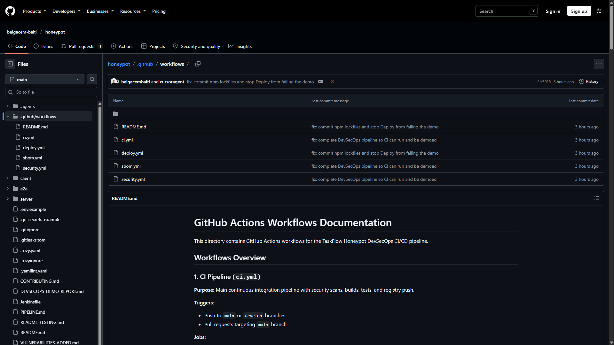
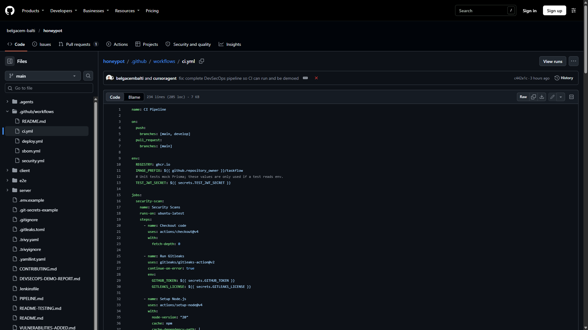
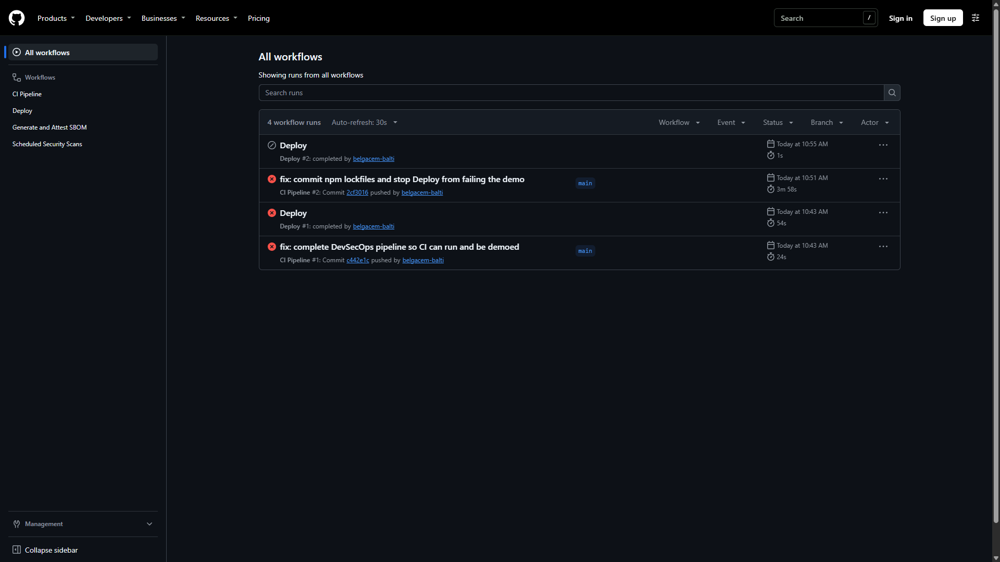
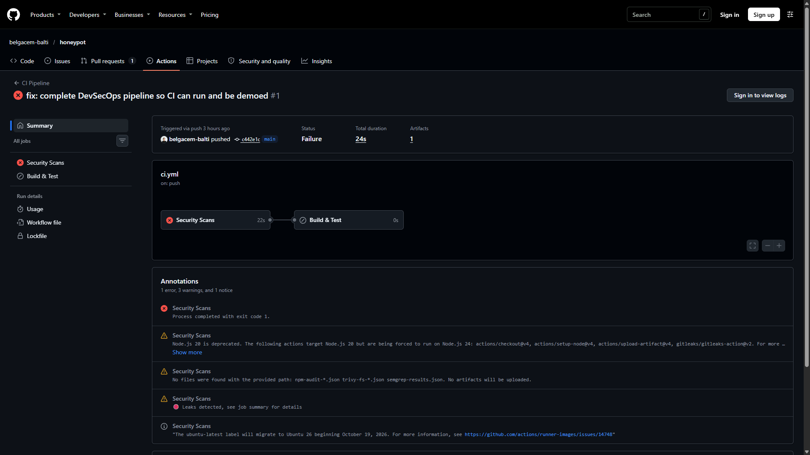
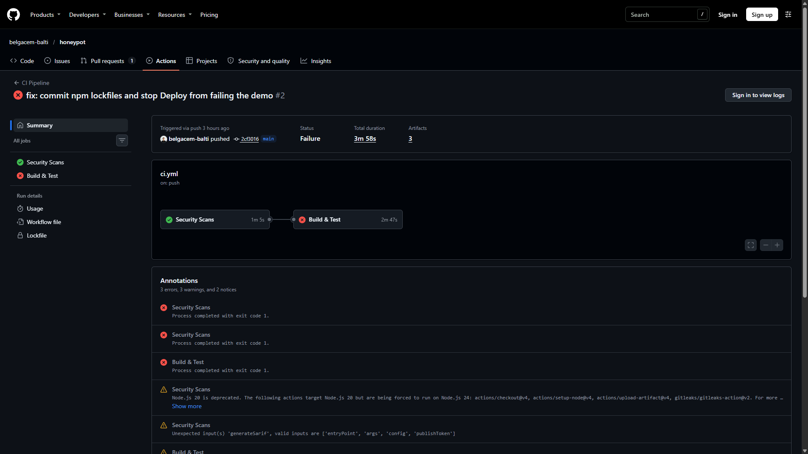

# DevSecOps CI/CD Pipeline Report

**Project:** TaskFlow honeypot  
**Repository:** https://github.com/belgacem-balti/honeypot  
**Platform:** GitHub Actions + Jenkins (equivalent stages)  
**Date:** 6 November 2026  

This report describes the CI/CD security pipeline: what existed before, what was added, why each tool was chosen, the risk each control addresses, and the impact of each workflow action. Evidence comes from real GitHub Actions runs on `main`.

---

## 1. Executive summary

TaskFlow is a React + Express + PostgreSQL application used as a **honeypot**: insecure defaults, old libraries, and planted secrets exist so scanners have something to find. Before this work there was **no CI/CD**. After it, every push to `main` runs secret detection, dependency and image scanning, SAST, unit tests, hardened Docker builds, and SBOM generation.

The pipeline is designed so that **evidence is produced even when the app is still vulnerable**. Scan jobs record findings as artifacts. They do not always fail the build, because this repository is intentionally insecure. In a production product the same stages would be fail-closed (Trivy `exit-code: 1`, Jenkins `FAIL_ON_CRITICAL=true`).

**Observed GitHub Actions results (6 Nov 2026):**

| Run | Commit | Result | Meaning |
| --- | --- | --- | --- |
| CI #1 | `c442e1c` | Failed in 24s | `npm ci` lockfile mismatch; Build & Test never started |
| Deploy #1 | `c442e1c` | Failed in 5s | Ran after failed CI; Compose had no secrets |
| CI #2 | `2cf3016` | Security Scans **passed**; Build & Test failed at GHCR push | Scans, tests, and hardened images all ran |
| Deploy #2 | `2cf3016` | **Skipped** | Correct: do not deploy after a failed CI |

---

## 2. Why a DevSecOps pipeline

Without automation, security is a late, optional review. A pipeline puts controls **on every commit**:

- Secrets cannot sit unnoticed in git history.
- Known CVEs in `package.json` surface before release.
- Insecure Docker patterns (root user, no healthcheck) are built and scanned in the same run as tests.
- An SBOM records exactly what shipped, for later CVE matching.

For this honeypot, the extra goal is **education**: show both a broken baseline (`Dockerfile.insecure`, `docker-compose.insecure.yml`) and a hardened path (`Dockerfile.hardened`, `docker-compose.prod.yml`).

---

## 3. Before vs after

### 3.1 Before (no pipeline)

| Area | State | Risk if left as-is |
| --- | --- | --- |
| CI | No `.github/workflows` | Broken or insecure code can be merged with no check |
| Tests | None (despite CONTRIBUTING.md) | Auth and XSS regressions unnoticed |
| Secrets | Hardcoded in Compose, Docker, K8s YAML | Credential theft, full database access |
| Images | Single-stage, often root, no HEALTHCHECK | Container escape / unmonitored crashes |
| Dependencies | axios 0.21.1, jsonwebtoken 8.5.1, lodash 4.17.x | Known RCE / ReDoS / prototype pollution |
| Deploy | Manual `docker compose` | No health gate, no audit trail |
| SBOM | None | Cannot answer “what did we ship?” after a CVE |

### 3.2 After (current pipeline)

| Area | State | Residual risk |
| --- | --- | --- |
| CI | Four workflows: `ci.yml`, `security.yml`, `deploy.yml`, `sbom.yml` | GHCR push needs `packages: write` (fixed in follow-up) |
| Tests | Jest (mocked Prisma) + Vitest TaskCard | Coverage still low (~30% server) |
| Secrets | `${VAR}` in Compose; `.env` gitignored; Gitleaks on history | Honeypot fixture files still contain fake secrets |
| Images | Multi-stage, `nodejs` UID 1001, nginx security headers | Intentional CVEs in app dependencies remain |
| Scanning | Gitleaks, npm audit, Trivy fs/image, Semgrep, ZAP | Gate is informational so the demo can finish |
| Deploy | Manual or after **successful** CI; skips if secrets missing | Staging/production GitHub Environments must be configured |
| SBOM | CycloneDX on images; attest on GitHub Release | Attestation needs a published release |

**Figure 1 — Workflow files in the repository**

**Figure 2 — `ci.yml` as stored in git**

---

## 4. Tools: why this one, and what it changes

| Tool | Why this tool | What it finds | Impact of the action |
| --- | --- | --- | --- |
| **Gitleaks 8.18.2** | Fast git-history secret scan; custom rules for `JWT_SECRET` and `DATABASE_URL` | AWS keys, JWT, DB URLs, private keys | Stops a leak **before** the image is built. Allowlist skips `node_modules` so CI does not time out. |
| **npm audit** | Native to Node; no extra binary | CVEs in npm graph | Forces visibility of axios/lodash/jwt issues. `continue-on-error` here because packages are pinned old **on purpose**. |
| **Trivy** (fs + image) | One tool for OS packages, libraries, misconfig, secrets, SBOM | CRITICAL/HIGH in Alpine, npm, Dockerfiles | Filesystem scan is cheap and early. Image scan catches what only appears **after** `docker build`. |
| **Semgrep** (`p/javascript`, `p/react`, `p/nodejs`, `p/security-audit`) | Pattern SAST, no compile step | SQLi, command injection, insecure crypto in `src/` | Catches `vulnerable.js` / `weak-crypto.js` that dependency scanners miss. |
| **Jest + Supertest** | Fits Express; Prisma is mocked | Auth register/login contracts | Proves the API still behaves after security edits, **without** a live Postgres in CI. |
| **Vitest + Testing Library** | Same Vite toolchain as the client | TaskCard XSS sanitization | Guards the UI against script injection in descriptions. |
| **Playwright** | Real browser E2E | Register/login in Chromium + Firefox | Not in CI yet (needs Compose). Used locally. |
| **Docker Buildx** | Repeatable multi-stage builds | N/A (build, not scan) | Produces the artifact Trivy and GHCR consume. Uses `Dockerfile.hardened`. |
| **GHCR** | Free registry tied to GitHub identity | N/A | Makes the scanned image available to deploy. Push failed on run #2 until `packages: write`. |
| **OWASP ZAP 2.14.0** | DAST against a running app | Runtime XSS, headers, auth issues | Complements SAST: sees nginx and live HTTP, not just source. Weekly / manual. |
| **CycloneDX SBOM** | Standard inventory | Component list for later CVE matching | Required for many compliance questionnaires. |
| **Jenkinsfile** | Same 11 stages for teams not on GitHub | Same as Actions | Shows the pipeline is not locked to one CI vendor. |

---

## 5. Risks the pipeline is meant to reduce

### 5.1 Application / honeypot risks (the “what if we shipped this”)

| Risk | Example in this repo | Pipeline control |
| --- | --- | --- |
| Credential leak | `kubernetes-secrets.yaml`, `.env.production` | Gitleaks + gitignore of real `.env` |
| Remote code execution | `node-serialize`, command injection route | npm audit, Semgrep, Trivy |
| Account takeover | Weak/hardcoded `JWT_SECRET` | Gitleaks + env substitution |
| Clickjacking / XSS | Missing nginx headers | Hardened `nginx.conf` + ZAP |
| Privilege escalation in container | Process as root | `Dockerfile.hardened` user `nodejs` (1001) |
| Unpatched base image | `node:14` in insecure Dockerfile | Trivy image scan on hardened `node:20-alpine` |
| Silent deploy of a dead app | No HEALTHCHECK | HEALTHCHECK + deploy `curl -f /api/health` |

### 5.2 Pipeline risks (the “what if CI is wrong”)

| Risk | What happened | Mitigation |
| --- | --- | --- |
| False sense of security | Honeypot CI can be green while CVEs exist | Report findings as artifacts; document informational gate |
| Blocking forever | Trivy `exit-code: 1` would fail every run | `exit-code: 0` for this repo only |
| Deploying a failed build | Deploy #1 started after CI #1 failed | `if: workflow_run.conclusion == 'success'` |
| Secret-less Compose crash | Deploy #1, 5 seconds | Skip deploy when secrets are empty |
| Scanning `node_modules` forever | Local Gitleaks `--no-git` hung | Path allowlist; CI uses git history |
| Lockfile drift | CI #1 `npm ci` failed | Commit `package-lock.json` |
| Unauthorized package push | CI #2 GHCR denied | `permissions.packages: write` |

---

## 6. Impact of each pipeline action (stage by stage)

Jobs in `ci.yml` are sequential: **Security Scans** must succeed before **Build & Test**. That is a control: we do not spend minutes building images if checkout or Gitleaks cannot even run. npm audit / Trivy / Semgrep are allowed to report issues without failing the honeypot job.

| Stage | GitHub step | If it works | If it is skipped or fails |
| --- | --- | --- | --- |
| 1. Checkout | `actions/checkout@v4` (`fetch-depth: 0`) | Full history for Gitleaks | Nothing else can run |
| 2. Secrets | `gitleaks/gitleaks-action@v2` | Leaks annotated on the run | Secrets can reach the registry |
| 3a. npm audit | `npm audit --audit-level=high` | JSON artifacts for client/server | Vulnerable deps ship unnoticed |
| 3b. Trivy fs | `trivy-action` on `client/` and `server/` | Early CVE/misconfig list | Same bugs found later, after a slower image build |
| 4. SAST | Semgrep rulepacks | Code-level vulns in PR | Only dependencies are checked |
| 5. Unit tests | `cd server && npm test` / `cd client && npm test` | Auth + TaskCard contracts | Broken API/UI still gets an image |
| 6. Build | `Dockerfile.hardened` | Non-root, healthcheck image | Registry would hold the insecure Dockerfile |
| 7. Image scan | Trivy `image-ref` | CVEs in the **built** layers | Shipping a clean-looking but vulnerable image |
| 8. SBOM | CycloneDX JSON | Inventory artifact (90-day retention) | Incident response has no component list |
| 9. Gate | Informational | Demo continues | Production should fail here on CRITICAL |
| 10. Push | `docker push` to GHCR | Deploy can pull a digest | Run #2: login OK, push denied without `packages: write` |
| 11. Deploy | `deploy.yml` | Health + smoke register/login | Must not run on failed CI (fixed) |
| 12. DAST | ZAP in `security.yml` | Runtime report HTML/JSON | Only static issues are known |

---

## 7. Evidence from GitHub Actions (screenshots)

**Figure 3 — Actions home: four runs (two CI, two Deploy)**

Left column: the four workflows (CI Pipeline, Deploy, SBOM, Scheduled Security Scans).  
Grey Deploy #2 is **skipped** (desired). Red CI #2 still failed at the last step (GHCR). Red CI #1 is the lockfile failure.

**Figure 4 — Before (CI run #1): Security Scans failed, Build skipped**

- Duration **24s** — never reached tests or Docker.  
- Annotation: **Leaks detected** (Gitleaks; expected on a honeypot).  
- Annotation: **no artifacts** for npm/Trivy because `npm ci` died first.  
- Graph: red Security Scans → grey Build & Test.

**Figure 5 — After lockfiles (CI run #2): scans and tests ran**

- Duration **3m 58s**.  
- **Security Scans green** (1m 5s): Gitleaks, npm ci, npm audit, Trivy fs, Semgrep, artifacts uploaded.  
- **Build & Test red** (2m 47s): server tests, client tests, both hardened images, Trivy image, SBOMs all **succeeded**; **Tag and push client image** failed (GHCR permission).  
- Artifacts: `security-scan-results`, `image-scan-results` (and related uploads).

That is the important “before/after” for the report: the pipeline moved from “cannot even install” to “full security and build path executed.”

### Extra screenshots you should add while signed in

Logs are hidden behind **Sign in to view logs**. After signing in, capture:

1. Security Scans → **Run Gitleaks** (leaks / allowlist).  
2. **Run npm audit (server)** (CRITICAL/HIGH from intentional pins).  
3. **Run Trivy filesystem scan**.  
4. Build & Test → **Run server tests** / **Run client tests** (4 + 4 passing).  
5. **Build client/server image** (`Dockerfile.hardened`).  
6. **Tag and push** error (packages permission) — useful “pipeline risk” evidence.  
7. Run summary → **Artifacts** download buttons.

---

## 8. Jenkins equivalent

`Jenkinsfile` mirrors the same stages with Docker-packaged tools (`gitleaks`, `trivy:0.50.1`, Semgrep, ZAP). Differences:

- Volume mounts assume a **Linux** agent (`${WORKSPACE}:/repo`).  
- Registry is Docker Hub via `docker-hub-credentials`.  
- Security gate counts CRITICAL in Trivy JSON; `FAIL_ON_CRITICAL=false` for the honeypot.  
- Deploy uses Jenkins secret text IDs: `jwt-secret`, `database-url`, `postgres-password`.

This shows the control set is **tool-based**, not GitHub-specific.

---

## 9. Recommendations

1. Keep `permissions.packages: write` on `ci.yml` so GHCR push can succeed for the demo.  
2. For a **real** product, set Trivy `exit-code: "1"` and Jenkins `FAIL_ON_CRITICAL=true`.  
3. Store `JWT_SECRET`, `DATABASE_URL`, `POSTGRES_PASSWORD` in GitHub Environments (`staging` / `production` with reviewers).  
4. Add more tests until coverage is meaningful; 70% was the original target.  
5. Run **Scheduled Security Scans** once for ZAP screenshots.  
6. Do not treat a green honeypot pipeline as “the app is secure.”

---

## 10. Conclusion

The project went from **no CI** to a complete DevSecOps path: secrets, dependencies, SAST, tests, hardened images, image CVE scan, SBOM, gated deploy, and optional DAST. GitHub run #1 proved why lockfiles and job order matter. Run #2 proved the security and test stages work in ~4 minutes. Remaining red status is a **registry permission**, not a missing scanner.

The value of each action is not “make the honeypot clean.” It is **repeatable evidence**: every push produces logs and artifacts a reviewer can attach to this report.

---

## Annex — Links

- Actions: https://github.com/belgacem-balti/honeypot/actions  
- CI run #1: https://github.com/belgacem-balti/honeypot/actions/runs/42204816549  
- CI run #2: https://github.com/belgacem-balti/honeypot/actions/runs/42205865589  
- Intentional vulns: `VULNERABILITIES-ADDED.md`  
- Operator notes: `PIPELINE.md`  
